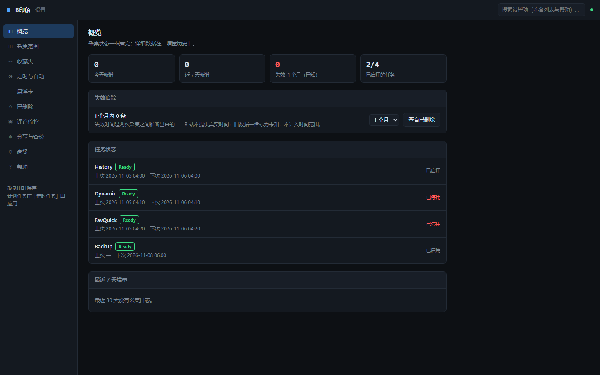

# B印象

<p><a href="README.en.md">English</a> · 中文（本页）</p>


把「看过什么、收藏过什么」变成磁盘上可检索的文件。核心是**失效追踪**：收藏会死——实测一份约 1.4 万条的收藏库，约 15% 已经失效；每一轮采集都会核对失效状态，并保留标题、UP、封面。

**三步开始**：① 从 [Releases](https://github.com/ireuln/bili-memory-public/releases) 下载发布包并解压（Windows 10/11，无需安装）；② 双击 `B印象.exe`，选数据目录；③ 右键托盘图标 →「扫码登录」，用手机 B 站 App 扫码。之后点「立即采集观看记录」，几分钟内就有第一份数据。

## 它是什么 / 不是什么

**是**：只归档**你自己账号**的观看记录、收藏夹、关注列表、稍后观看，存成本地文件；可选的公开内容快照（热门评论、弹幕）默认关闭。

**不是**：

- 不是视频下载器，不抓取他人账号数据；
- 不是 B 站客户端备份/迁移工具（不备份动态、私信全文、账号设置）；
- 没有上传、云同步或遥测。

## 风险与边界（先读这一段）

- **平台条款**：B 站用户协议 4.2.11 禁止"以自动程序、脚本获取平台数据"，条文字面没有"本人数据除外"。本项目不声称获得书面许可，也不提供规避平台规则的能力——是否使用由你自行判断。详见 [`docs/安全与边界.md`](docs/安全与边界.md)。
- **账号**：走网页端自用接口，不是开放 API。频率越高越可能限流、临时封禁或让登录态失效；接口随时可能变。
- **隐私**：观看史能推断政治倾向、情感与健康状况。数据只写本地、无上传；`登录态\` 目录**等价于账号**，不要拷贝、上传、分享。
- **杀软误报**：未签名程序可能被火绒/Defender 拦截（尤其 `start.cmd` 与隐藏 PowerShell）。恢复隔离 + 信任工具目录，**不要关闭全局防护**。见 [`docs/运维与排障.md`](docs/运维与排障.md)。
- **凭据只属于你**：不要把 cookie / SESSDATA / 登录态贴进 issue、群聊或别人的 AI；公开 = 已泄露，立刻换登录态。分享日志前按 [`SECURITY.md`](SECURITY.md) 脱敏。
- **只从官方 Release 下载**：群文件、网盘、fork 重打包都无法验证。解压后可跑 `verify-files.ps1` 比对 `SHA256SUMS.txt`。

## 你会得到什么

| 产出 | 内容 |
|---|---|
| 收藏总表 `.jsonl` | 收藏条目 + 失效标记/时间 |
| 失效清单 | 失效收藏的时间、UP、原收藏夹、本地封面 |
| 收藏可读表 `*.md` | 按收藏夹整理 |
| 封面快照 | 320px，视频没了还能认出 |
| 观看记录 `YYYY-MM.jsonl` | 最近约 1200 条，每日增量 |
| 报告 `report-*.md` | 时长、分区、UP 排行、完成度、失效率 |

## 功能一览

| 模块 | 能做什么 | 状态 |
|---|---|---|
| 观看记录 / 收藏 / 关注 / 稍后观看 | 定时采集、增量、失效追踪 | 默认开启 |
| 查询 / 报告 / 分享卡 | 只读，不联网；卡片可离线生成 | 实测 |
| 备份 | ZIP 默认，`-Encrypt` 时 7z AES-256，双目标、保留 5 份 | 实测 |
| 设置页 | 本地网页（loopback、一次性 token、30 分钟自退） | 0.1.7 起 |
| 悬浮卡 | 近期优先、可配置指标 | 0.1.7 起 |
| 失效通知 | 收藏采集发现新失效时发系统通知 | 0.1.7 起 |
| 评论/弹幕抓取 | `fetch-media.ps1`，手动、低频、默认不运行 | 可选 |
| 常驻评论监控 | 本地内测，未随公开版发布 | 未发布 |

## 快速开始

```powershell
# 首次安装（或双击 B印象.exe 走安装窗口）
powershell.exe -NoProfile -ExecutionPolicy Bypass -File .\setup.ps1

# 扫码登录（托盘右键「扫码登录」也行）
powershell.exe ... -File .\collect.ps1 -Login

# 第一次采集
powershell.exe ... -File .\run-task.ps1 -Mode history
powershell.exe ... -File .\run-task.ps1 -Mode fav -TimeoutMinutes 90
```

完整参数、计划任务与排错见 [`docs/使用指南.md`](docs/使用指南.md) 与 [`docs/运维与排障.md`](docs/运维与排障.md)。

### 设置页

托盘「详细功能与设置」打开本地网页：只绑 `127.0.0.1`、随机端口、一次性 token、30 分钟空闲自退。原生 `B印象.exe -settings` 保留为回退。



### 可选：抓一条视频的热门评论 + 弹幕

```powershell
powershell.exe ... -File .\fetch-media.ps1 -Bvid BV1xxxxxxxxx -Hot 50
```

每视频 2–3 次请求，只写本地 `content\<BV>\`；默认不运行、不进计划任务。

## 界面语言

`config.json` 的 `"UiLanguage": "en-US"`（或安装窗口里选）切换托盘/提示/分享卡为英文；数据路径与标题保持原样。详见 [`README.en.md`](README.en.md)。

## 数据、磁盘与卸载

默认数据目录由安装时选盘决定，几百 MB 起。卸载见 [`docs/安全与边界.md`](docs/安全与边界.md) 与 `uninstall.ps1 -Check`（先看再删）。

## 常见问题

- **要登录态吗？** 要。工具不导出 cookie，登录态只在专用 Edge 配置目录里。
- **接口会变吗？** 会，失效属预期内；见 [`docs/计划与状态.md`](docs/计划与状态.md)。
- **能多账号吗？** 不设计多账号，单机单账号自用。

更多见 [`docs/README.md`](docs/README.md)。

## 文档

| 想了解 | 看 |
|---|---|
| 能力与限制 | [`docs/能力说明.md`](docs/能力说明.md) |
| 使用与参数 | [`docs/使用指南.md`](docs/使用指南.md) |
| 排错与日志 | [`docs/运维与排障.md`](docs/运维与排障.md) |
| 风险与边界 | [`docs/安全与边界.md`](docs/安全与边界.md) |
| 数据格式 | [`docs/数据契约.md`](docs/数据契约.md) |
| 自动化接口 | [`docs/自动化接口.md`](docs/自动化接口.md) |
| 给 AI 的说明 | [`llms.txt`](llms.txt)、[`docs/AI-交接说明.md`](docs/AI-交接说明.md) |
| 计划与状态 | [`docs/计划与状态.md`](docs/计划与状态.md) |
| 打包与移植 | [`docs/打包与移植.md`](docs/打包与移植.md) |

## 交流与反馈

**欢迎测试、提需求、报 BUG、交流用法。**

- **报 BUG**：用 [Issues](https://github.com/ireuln/bili-memory-public/issues)，附版本/系统/复现步骤；**不要贴 cookie / SESSDATA / 登录态目录 / 含真实标题与 uid 的日志**。
- **提需求**：同走 Issue，说清"想备份什么、现有哪里不够"。
- **不回应/不实现的需求**：批量下载、绕过风控/会员、抓他人数据、账号交易、自动化刷量、任何对抗平台的能力——边界之外。
- 开 issue/PR 第一行写 `To: human` / `To: ai` / `To: either`；PR 先开 Issue 对齐。

## 关于你的权利

这是**你自己账号数据**的副本：导出与自用由你决定；但平台条款与内容著作权是另一回事，备份自用和公开再分发完全不同。本工具不含破解/绕过/去除 DRM 的能力。以上不是法律意见。详见 [`docs/安全与边界.md`](docs/安全与边界.md)。

## 关于作者 / 许可

普通用户，不是律师；工具按现状提供，风险自担。GPL-3.0，见 [`LICENSE`](LICENSE)；第三方与致谢见 [`NOTICE.md`](NOTICE.md)、[`docs/致谢.md`](docs/致谢.md)。
